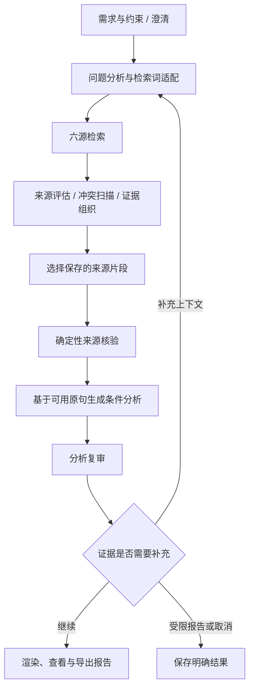

# DeepChoice — AI驱动的技术选型研究Agent

> 2026-10-10最新真实检查：`delivery-fresh-cases` v1.0.0三类请求加一次预定重复，
> cf065dc内容0/4通过；仍存在重要缺答、一项候选排除错误及重复依据丢失。
> 当前正在修复官方正文传递和网页查询覆盖，尚未达到求职作品内容交付标准。

DeepChoice基于Python/LangGraph，面向单用户可信网络内的技术选型：输入需求与候选后，
检索多种来源、比较证据并生成可查看和导出的报告。报告区分来源事实、模型推断与未知项。

## 能做什么

- 输入原始需求、候选技术和约束，通过澄清界面确认研究任务。
- 从网页、官方文档、GitHub、arXiv、社区与本地知识库检索材料，保留来源失败和证据冲突。
- 先选择、绑定并核验来源，再生成有原句依据的条件分析；报告同时列出未能回答的问题。
- 在 Streamlit 查看进度、来源、预算和报告，处理补充信息请求，并导出 Markdown、HTML 或 PDF。
- 通过持久任务 API 查询、取消、重试或恢复任务；SQLite 保存任务状态与独立的图检查点。

## 使用边界与验证状态

报告用于辅助技术选型。引用 `verified` 表示有界网页可达性与词法检查通过；模型推断仍需
核对来源适用性，报告不表示部署验证已经完成。无充分依据时保留明确缺口，不编造结论。
当前是单用户可信网络部署，API 未提供认证或任务所有权，运行时只支持单实例、单 worker。

2026-10-09的三类请求及一次预定重复均完成运行，但独立助手内容复核为0/4通过，
主要缺口是关键问题缺答与分析不稳定；后续一次已暴露请求诊断仍未通过，虽保留6条来源链，最终判断仍无可用事实。
一次请求在检索阶段因运行健康停止；2026-10-10新的已暴露诊断完成，但内容仍0/1。
网页截断及受限报告清除分析已修复；同一已暴露请求回归保留了3条审核分析，但关键问题
仍缺答，独立内容复核0/1。随后移除候选完整标签与同标题歧义对已编号材料的重复否决，
其同题回归仍0/1，关键问题没有得到有效回答。递进语句和行内代码修复后的回归也为0/1。
当前复用句级审阅保留部分可核验原句，并区分事实与条件建议，尚未取得合格报告。不能用历史 300 例指标
或离线测试通过率声称当前报告普遍可靠。现行结果与范围见[执行状态](docs/o1-execution-status.md)，
历史测量保留原日期、数据集与分母。研究入口不预填固定案例。

## 设计重点

1. **依据先于判断**：来源选择和判断沿用两次模型调用，中间执行一次确定性来源核验。
   被拒绝的依据不提供给判断模型；网络未确认材料保持未知标记，模型推理仍须复审。
2. **原始需求与来源保真**：比较对象优先获得官方检索名额；选择菜单展示来源 hostname，
   带部署/版本修饰的候选允许检索产品本身资料，但仍保留原始适用条件待核实。
   原句与未答问题贯穿报告；hostname 和评分用于选择材料，不证明内容可信。
3. **运行可恢复、费用有上限**：任务事件与状态原子保存，检查点受版本和执行权校验；
   外呼前执行预算准入，同源成功检索支持 TTL 缓存，故障不会变成空成功。
4. **有界外部输入**：官方正文和引用网页获取最多1 MiB，提取正文最多64 KiB；动态 URL
   经过安全获取。受限报告保留仍有依据且已审核的分析，输出 HTML 清洗后展示与导出。

工程契约与历史版本兼容规则见[运行手册](docs/phase1-runtime-contract.md)。

## 快速开始

先安装 Python 3.11 或 3.12；以下 Windows 示例用 Python Launcher 选择 3.12。
已有受支持的 `.venv` 可直接使用。配置 DeepSeek/Tavily 密钥后，实际研究会调用
外部服务并可能产生费用。评估工具另见 [评估入口](benchmarks/README.md)。

```powershell
# 1. 在项目根目录创建环境并安装
py -3.12 -m venv .venv
.\.venv\Scripts\python.exe -m pip install -e ".[dev]"

# 2. 在项目根目录的私有 .env 或进程环境中配置 API Key（不要提交 .env）
# 所有 LLM：DS_FLASH_API_KEY，兼容 FLASH_API_KEY / DEEPSEEK_API_KEY
# Tavily：TAVILY_API_KEYS（逗号分隔），或单个 TAVILY_API_KEY
# 可选：GITHUB_TOKEN、STACKEXCHANGE_API_KEY

# 3. 启动后端
.\.venv\Scripts\python.exe -m uvicorn deepchoice.server.app:app --reload

# 4. 开新终端，启动前端
.\.venv\Scripts\python.exe -m streamlit run frontend/app.py
# 浏览器打开 http://localhost:8501
```

在前端填写比较问题、候选和约束后提交；任务进度与最终状态在页面显示。若出现
“需要更多信息”，可补充背景继续、基于已有证据生成受限报告或取消。完成后在“报告”页
核对引用与未知项，再按需导出 Markdown/PDF。失败或受限状态不代表已作出可靠选型。
默认后端 `API_BASE` 为 `http://localhost:8000`，前端可通过同名环境变量连接其他受信地址。

### 配置

在项目根目录的 `.env` 或进程环境中设置。密钥不得提交到仓库。

| 配置 | 用途与默认行为 |
|---|---|
| `DS_FLASH_API_KEY` | 所有 LLM 调用；兼容 `FLASH_API_KEY` / `DEEPSEEK_API_KEY` |
| `DS_FLASH_MODEL` / `DS_FLASH_BASE_URL` | 默认 `deepseek-v4-flash` / `https://api.deepseek.com/v1`；兼容 `FLASH_MODEL` / `FLASH_BASE_URL` / `DEEPSEEK_BASE_URL` |
| `TAVILY_API_KEYS` / `TAVILY_API_KEY` | 网页检索，多个密钥用逗号分隔 |
| `GITHUB_TOKEN` / `STACKEXCHANGE_API_KEY` | 可选的社区数据凭据 |
| `LOCAL_PROXY`、`FWD_BASE`、`FWD_KEY`、`FWD_TARGETS` | 可选出站代理/转发；转发目标按 hostname 边界匹配 |
| `OUTBOUND_CHANNELS`、`OUTBOUND_CHANNELS_COMMUNITY`、`OUTBOUND_CHANNELS_TAVILY` | 各来源的通道顺序；Tavily 不允许会丢失 POST body 的 `self-forward` |
| `SAFE_FETCH_TRUSTED_LOCAL_PROXY` | 默认空值关闭；动态 URL 安全抓取的显式本地代理信任配置，见下文 |
| `CHROMA_PATH` | 默认 `./chroma_kb/chroma_db`；约束本地检索与冲突工具的库路径 |
| `LEARNED_DOCS_PATH` / `LEARNED_DOCS_READONLY` | 默认 `./learned_docs.json` / `0`；设为 `1` 禁止学习写回 |
| `TAVILY_KEY_STATE_PATH` / `TAVILY_REPROBE` | 保存耗尽密钥状态；默认不重新探测已耗尽密钥；Docker 默认状态文件在 `outputs` volume |
| `RETRIEVAL_CACHE_ENABLED` | 默认 `1`；`0` 关闭持久化检索缓存，无 LLM 响应缓存 |
| `LLM_DS_CONCURRENCY` | 默认 `80`，限制冲突扫描、仲裁和再仲裁调用；不替代单次研究预算 |
| `DEEPCHOICE_SYNTH_THINKING` | 默认 `0` 显式关闭 thinking；`1` 为综合调用启用并冻结进 run manifest |
| `API_BASE` | 前端连接的后端，默认 `http://localhost:8000` |

旧 Qwen 的 `QW_FLASH_*`、`PRO_*`、`LLM_*` 与 `LLM_QW_CONCURRENCY` 已退役，
不会向 DeepSeek 提供备用凭据。历史 `qwen-flash` 调用选择器仅为兼容适配器。

动态 URL 只能使用经安全校验的出站抓取。若确需本地代理，`SAFE_FETCH_TRUSTED_LOCAL_PROXY`
必须与所选 `LOCAL_PROXY` 相同，格式为 `http://<loopback-literal-IP>:<explicit-port>`，
禁止认证、路径、query、fragment、尾部 `/` 或空白；只接受动态 HTTPS:443 目标。
信任仅在具有冻结 manifest 的持久化任务中生效。Docker 中 loopback 指容器自身。
完整配置与安全语义见[运行契约](docs/phase1-runtime-contract.md)。

### 运行、报告与恢复

- 新调用方使用 `/api/v1/tasks/*`；本地 API 文档在 `http://localhost:8000/docs`。
  旧 `POST /research` 是一版弃用兼容入口。
- 任务状态、结果与完成事件原子写入产品 SQLite；页面用 SSE 显示进度。网络断开后通过
  任务快照与事件游标续接，故障保持可见。可恢复的中断续接兼容检查点，失败/超时重试创建新 run。
- 证据不足时只有一个人工决策点：补充信息、生成受限报告、取消。重复提交相同动作幂等，
  过期/冲突动作不会恢复旧执行。报告、快照与 Markdown 导出来自同一保存结果。
- 新 run 冻结 `research-v5` / state v3。来源选择后先执行一次确定性核验，再生成条件分析和复审；
  不再让已拒绝的来源进入第二次模型判断。旧 workflow v1–v4 可读，不能跨版本恢复。
- `verified` 是有界页面检查与词法支持状态。临时网络不确定性保留为 `unknown`；
  受限的句子级分析须经复审并显示限制。引用状态不能证明语义、性能或生产可用性。
- 每 run 标准上限为 60,000 token、96 次 LLM、72 次检索、900 秒 active-time，80% 时提示。
  调用前预留预算；未知用量保守结算，价格未知不显示为零成本。达到上限后停止外呼，
  仅在已有证据满足结构条件时生成受限报告，否则明确失败。
- 产品数据库 `outputs/deepchoice.db` 与检查点数据库 `outputs/checkpoints.db` 必须成对备份；
  不得通过增加 worker 或副本共用 SQLite。恢复步骤见[运行契约](docs/phase1-runtime-contract.md)。

### 测试

```powershell
.\.venv\Scripts\python.exe -m pytest -q -p no:cacheprovider --basetemp=.codex-test-tmp
.\.venv\Scripts\python.exe -m benchmarks.run_offline_eval --check-baseline
```

`smoke-v1` 是 12 例离线 fixture 验证，不调用 LLM/网络，不证明真实报告质量。
完整验证和当前真实测量见[当前状态](docs/o1-execution-status.md)。CI 在 Python 3.11/3.12
运行测试、smoke、pyflakes 和 vulture。不要使用混装其他项目依赖的全局 Python 环境。

### Docker 部署

```bash
docker compose up --build
```

打开 `http://localhost:8501`。后端与前端使用 Python 3.12，后端保持单 worker；
`outputs` 与 Chroma 数据通过 volume 保存。BGE-M3 嵌入模型首次使用需要下载较大的模型文件，
模型缓存位于后端容器 `/root/.cache/huggingface`，可挂载 volume 保留缓存。

当前部署范围为单用户、可信主机/网络；API 没有身份认证或任务所有权校验。
远程访问应配置带认证的反向代理，不要直接向公网开放 8000 端口。

备份前停止服务或进入维护模式：

```bash
python scripts/runtime_db.py backup --product-db outputs/deepchoice.db --checkpoint-db outputs/checkpoints.db --destination backups/runtime-YYYYMMDD --maintenance-confirmed
python scripts/runtime_db.py verify --backup-dir backups/runtime-YYYYMMDD
python scripts/runtime_db.py exercise --backup-dir backups/runtime-YYYYMMDD --drill-dir restore-drill
```

## 架构概览



FastAPI 提供任务 API 与 SSE；Streamlit 提供中、英、日、韩界面。任务状态与事件存于产品
SQLite，LangGraph 检查点存于独立 SQLite，两库按配对备份恢复。所有模型调用通过统一 helper
执行预算、重试、脱敏与用量记录；来源检索统一通过 outbound 路由。

## 关键技术决策

- **来源排序采用确定性规则**：URL 类别、日期等提供可解释的排序先验，不能代替事实检查。
- **冲突扫描与判断分开**：先用嵌入相似性选择候选对，再做有界模型扫描；当前完整链路不执行旧两阶段仲裁或额外补搜。
- **先核验依据，再写分析**：避免先基于不可用来源生成整段分析、随后整段撤回；引用核验与推理复审各自保留职责。
- **版本化恢复**：运行时冻结工作流、模型参数和资产身份，拒绝用新逻辑接续不兼容的旧检查点。

## 量化指标（300 case 混合基准，2026-08-31 终测）

150 对比场景（TC）+ 150 开放场景（OS），覆盖技术选型对比与真实业务需求描述两类输入。300 case 按 TC/OS 交错重排、拆 3 批跑（每批 50 TC + 50 OS），超时/变体补跑后合并。

| 指标 | 值 | 说明 |
|------|-----|------|
| Top-1 准确率 | **92.0%**（287 可判定） | 推荐排名第一的技术匹配人工标注正确答案（13 个 TC 为 context_dependent 标注——无单一正确答案，按设计不计入 Top-1） |
| 任务成功率 | **100%**（300/300） | 零失败——str.get bug 已根除（`llm.py` 兜底）+ 超时补跑 |
| 声明溯源率 | **93.0%** | 历史精确口径（claim_citation_rate）：每条事实声明带 `[Source: title]` 且 title 真实存在于证据链；**伪造引用 0**（后置校验剔除幻觉引用）。该 2026-08-31 指标不包含后来加入的在线可达性/词法支持验证 |
| 信源召回率 | **66.7%** | official_doc 65.6% / github_repo 73.0% / package_registry 50% / academic+community ~100%（300 case，与 200 case 66.2% 持平） |
| official_doc 召回率 | **65.6%**（346/528） | 官方文档直连 222 条（91 种子 + 131 运行时自学习入库，2026-08-31 种子化） |
| 端到端延迟 P50 | **342.1s** | 中位数——约 5.7 分钟完成一次技术选型研究 |
| 端到端延迟 P95 | **445.3s** | 95 分位——480s 预算内 |
| 报告质量 A 级 | **99%**（297/300） | 5 项确定性质检（不调 LLM） |

> **数据来源**：以上数字来自 300 case 混合基准（`benchmarks/cases_eval_300.json` = 150 TC + 150 OS）。采集分 3 批（`--batch 1/2/3 --batch-size 100`），超时/变体集中补跑（`cases_retry_all.json`）后按 case_id 替换合并。评测覆盖经 3 轮审计修正（case 标注缺陷 T1/T2/T3 修正、OS acceptable 补齐托管维度、变体 query 双场景矛盾清除）。**诚实口径**：Top-1 92.0% 是修正评测覆盖后的真实值——剩余 miss 为真·两难（标注无共识，按设计保留）、模型主流偏差、以及模型真错（详见 case 审计记录）。2026-08-31 终测归档；当前代码测试基线见上方“测试”小节，不能用后续测试数量反推历史 benchmark 指标。

上述 300-case 是 2026-08-31 的历史结果；当前模型、代码和评估路径已有变化，重跑旧案例不等于
重现当时数字。旧直连工具与停用批次脚本的边界见[评估入口说明](benchmarks/README.md)。
当前产品测量使用持久化 API，按批次冻结输入与版本；旧 product-baseline-v1 的 12 例记录
属于另一数据集。当前状态见[执行记录](docs/o1-execution-status.md)，不得混入上述 300-case 分母。历史停止和修复经过见
[归档索引](docs/archive/README.md)。手动评估 workflow 仅运行 smoke-v1，不调用 LLM/检索服务。

**历史局限（2026-08-31，300-case）**：端到端延迟 P50 342.1s/P95 445.3s，原记录使用 480s
超时口径；冲突检测率为 28.8%，解释受当时 known_contradictions 标注覆盖影响。这些数据不代表
统一 Flash 后的耗时或冲突质量；当前 active-time 预算见运行契约。Tavily 配额仍是外部运行条件。

## 技术栈

LangGraph（研究/生成节点 + 确定性引用验证与单一 HITL 决策门 + checkpoint + 条件路由） · FastAPI + SSE · Streamlit（深色主题 + 4 语言 + 观测面板） · DeepSeek Flash（全部 LLM 调用） · BGE-M3 嵌入 · ChromaDB · Tavily（密钥池） · GitHub/ArXiv/StackExchange API · xhtml2pdf（PDF 导出） · Pydantic v2 · pytest

## 项目结构

```
src/deepchoice/
├── agents/          # 研究/生成节点与确定性引用验证节点
├── citations/       # 引用状态契约、规范 URL 与确定性支持度验证
├── contracts/       # API、结构化错误与不可变 RunManifest
├── retrievers/      # 6 路检索器（稳定 retrieve 契约 + 兼容 search 接口）
├── outbound/        # 出站通道路由、代理/转发、探测与审计
├── clarify/         # 前置澄清模块
├── formats/         # 3 种报告格式
├── server/          # FastAPI（29 端点：app.py 25 + clarify_routes 4，含 durable decision、Trace 摘要与 SSE）
├── state.py         # ResearchState TypedDict
└── utils/           # LLM 客户端 / BGE-M3 嵌入

benchmarks/
├── metrics.py             # 7 指标计算（GSM 框架）
├── README.md             # 当前/历史评估入口及执行边界
├── run_baseline.py        # 显式选择的历史直连实验，非 durable 基线
├── merge_checkpoints.py   # 历史合并实现（CLI 停用）
├── report_quality.py      # 5 项确定性质检（A/B/C/D 评级）
├── cases_200.json         # 200 对比场景 case（50 标注 + 150 变体）
├── cases_eval_200.json    # 200 混合基准（100 TC + 100 OS）
├── run_all_batches.ps1    # 历史入口（已停用，不删除旧结果）
├── locustfile.py          # durable 只读 HTTP 负载，不测研究吞吐
└── annotated_cases.json   # 50 手标注 case
```

## License

MIT


当前质量测量的事实与下一成果见[状态](docs/o1-execution-status.md)，跨类别开发准入与保留集边界见[协议](docs/product-effectiveness-optimization.md)。旧四例采集相位和晋级锁不能授权新样本；最终24次仍封存。
