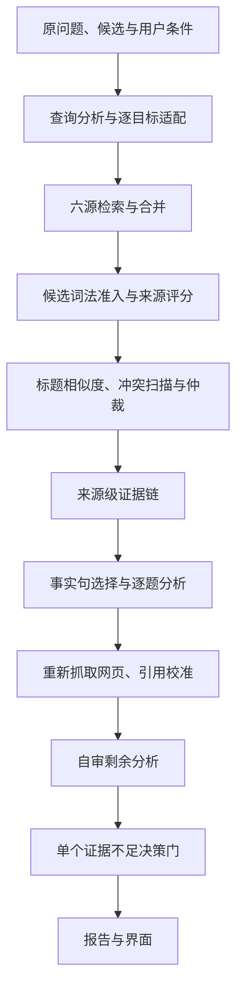

# 全仓代码审计与精简地图

审计日期：2026-10-05。代码身份：`8ca1a783d89734751897c347c640bcf048f97007`；
审计开始时仓库 HEAD 为 `0a78df6`，其后只有审计文档变更。本文面向后续维护者，记录
可复核的机制、覆盖边界和修复依赖；研究账本只在[当前状态](o1-execution-status.md)维护。

后续修复记录：R1隐藏SDK重试已完成工程验证与独立复核，结果见
[当前状态的R1检查点](o1-execution-status.md#r1完成与暂停检查点2026-10-05)。2026-10-06用户取消暂停；
R2a已修复目标索引丢失、Tavily/GitHub顺序挤占及GitHub表达式拆分；R2b处理动态文档正文
和映射变化后的旧空缓存；R2c处理动作型候选词法准入；R3a保全扫描标记/未知并移除默认仲裁与补搜；R3b以完整来源坐标与所有冲突的合并限制保留远处原始事实，R4允许显式空的额外假设并跳过无对象自审，验证状态见
[当前状态](o1-execution-status.md)。其他查询覆盖与实际模型推理保留仍有验证限制。下文保留审计基线事实。

最新累计审查见[第8节](#8-多轮修复后的累计逻辑审查2026-10-07)。前文是2026-10-05基线，
不能据R1–R7逐轮完成推断全部发现已关闭。

## 1. 结论与证据等级

已确认多个不依赖真实案例即可触发信息丢失或多余工作的实现路径。最主要的结构问题是：原始需求、检索
目标、来源正文、事实句和回答之间缺少一致的传递契约；各阶段用不同粒度筛选，前期丢失
的材料不能由下游自审恢复。继续仅调整句段范围、提示长度或运行另一道题，无法修复这一链路。

本文区分三类证据：**复现**是合成输入、内存 stub、零外呼执行所得；**静态**是当前默认
可达路径的直接代码事实；**风险**是尚未验证实际影响的推断。代码事实不能量化其对全部
历史失败的贡献，也不能证明修复后的真实选型质量。原有安全与运行时工程仍承担必要职责。

审计由主审和三个分区只读探索者完成；测试按契约与调用边界抽样，没有逐行重读全部测试、
历史控制器和冻结素材。独立复核状态在第 7 节记录。没有调用真实模型、检索服务或启动新研究。

## 2. 默认路径与问题位置

`agents/orchestrator.py:_create_workflow` 的实际顺序是引用校验→自审→决策门→报告。
只有 HITL 的 `provide_context` 返回查询适配；不存在自审后自动补搜的图边。
六源、冲突仲裁、证据链、引用和自审这些名称本身不证明信息经过了有效研究与保留。

### A1. 候选身份和决策动作混在一个匹配字段（复现／高）

`agents/source_evaluator.py:_candidate_patterns/_mentions_candidate` 与
`utils/evidence.py:candidate_name_pattern`
用完整候选字符串匹配标题/摘要。候选如“继续使用 Atlas”，来源仅写“Atlas”时会被排除。
这发生在评分之前；模型再好也无法从被排除的结果生成有据回答。已有保存材料的零外呼
词法回放也发现同一路径，但不把该回放当作完整来源评估器重跑。

修复方向：分开产品身份与选择动作，使用通用候选规范化契约；保留来源相关性与来源范围
约束，不能直接删除相关性门，也不能硬编码案例技术名。

### A2. 查询适配产物在检索器内被截断或改写（复现／高）

- `retrievers/tavily_search.py:_do_search` 对全部查询外呼后按查询顺序拼接、去重、截前 7 条。
  内存 stub 对 5 条查询各返回 3 个唯一结果时，最后分布是 **3/3/1/0/0**。每条请求的
  `max_results=3` 只是请求参数，并非真实服务保证返回 3 条。后两题产生调用却没有材料进入下游。
- `retrievers/github_api.py:_do_search` 将适配的搜索语法拆成最多 4 个词，去掉 `repo:`。
  输入 `repo:acme/worker language:python stars:>100` 实际变成三个独立 q 参数。
  返回主要是仓库元数据；它不直接证明技术行为或生产适用性。
- `retrievers/arxiv_api.py`、`community.py` 只使用第一条适配查询。上游逐问题生成的数组
  因此不等于各问题真的被研究。
- `agents/query_adapter.py` 不验证 `sub_question_index` 覆盖；某检索器只收到一条查询就
  不再补齐缺失目标。`fallback_retrievers` 在补齐后计算，不能准确记录发生过的回退。

修复方向：先建立“问题→查询→结果”的有界分配，再统一合并与去重；保留各服务原生查询
语法。不是提高总结果数或再加检索器。

### A3. 官方发现路径返回无法使用的占位证据（复现／高）

`retrievers/official.py:_do_search` 只有 curated catalog 命中才加入正文读取 roots。
LLM 回退和 learned-only 命中可以返回 URL/标题，却不加入 roots；返回的
`Official documentation site for ...` 又被 `source_evaluator.py` 排为导航文本。
内存 stub 已复现：URL 校验成功、正文读取 roots 为空、最终评分来源为 0。
因此“发现了官网”不等于获得官网内容。学习映射的持久化使路径更复杂，却没有补上正文读取。

修复方向：统一官方候选 URL 到有界正文获取的入口，或删去不能贡献正文的默认支路。
保留完整 hostname/path、SSRF、大小/时间边界；不能以导航占位页充当事实。

### A4. 冲突仲裁和证据准入脱节（复现／高）

`agents/conflict_detector.py` 先按标题向量相似度筛对，再用短摘要判断冲突、仲裁，低置信
时还补搜。`agents/evidence_chain.py:build_evidence_chain` 随后不区分 `A_correct`、
`B_correct`、`both_partial` 或证据不足，把双方 URL 都标成 disputed；
`utils/evidence_choices.py:eligible_source_fact_ids` 拒绝 disputed 链。
合成输入为两个有效来源、仲裁 `A_correct/high` 的探针，事实准入从 `{1,2}` 变成空集。

当前分步合成不直接消费冲突仲裁说明；补搜正文也没有作为带来源的新增证据进入 source_scores。
一个局部争议可以排除整篇来源，仲裁费用不能自动换回可用事实。扫描普通异常还可返回 None，
因此未发现冲突与扫描不可用在该列表层并不等价；诊断需查 Trace。

修复方向：明确冲突所指的具体主张及适用条件，并让新增材料沿同一来源契约进入后续。
优先评估收缩/移除无效的默认仲裁支路；不能直接相信 LLM 仲裁并解除全部争议保护。

### A5. 证据单位不一致，多个长度与资格门串联（静态／高；历史影响比例未知）

`fact_selection.py`、`evidence_choices.py`、`citations/source_windows.py` 与
`citations/verifier.py` 分别限制候选片段、事实文本、定位窗口和校验句数。检索摘要可能
包含省略、表格转写或拼接；引用校验则要求选中文本在重新抓取的网页中能唯一、完整定位。
搜索摘要与正文表示不同，即使运行时逐字复制摘要，也不保证能定位原网页。

`calibrate_evidence_choices` 先按整条事实合并引用状态；分析再要求自身所有事实均有可审资格。
网络不确定与特定混合限定句存在有限保留分支，`content_insufficient` 等未知不能因此得到
同样资格。最后的自审仅审剩余事实/分析，无法找回更早丢掉的材料。

修复方向：在检索后形成有来源、完整限定条件的有界证据单位，让选取、引用、分析和自审
共享它；先处理表示与契约错配。不得把 unknown 升级 verified，或靠扩大数字上限掩盖问题。

### A6. 合理回答被强制要求包含未知假设（复现／高）

`utils/decision_analysis.py:bind_decision_analysis` 拒绝 `assumptions=[]`；合成与自审
提示也要求 1–4 条。一个完全由已给用户条件与保存事实支持的回答仍可能被删除，或被迫
把已知条件写成待确认。合成输入已复现 `invalid_assumptions`。

修复方向：明确用户已陈述条件、来源事实与真正未确认前提；允许没有额外假设的回答。
仍要求不充分的场景条件在推理中显式保留，不允许把未知当作既成事实。

### A7. 多套回答表示与反复重建增加维护复杂度（静态；质量影响属风险）

当前默认合成生成 compact facts/decision_analysis，但 `answer_delivery.py` 将其包进旧的
winner/ranked_options/requirement_assessments/action_plan 结构，再将 winner 固定为
context_dependent、confidence 固定 low、清空旧排序字段。合成节点还先构造默认分步路径
不使用的旧大提示与冲突摘要，再运行旧 winner/constraint-fit、弃权与绑定步骤。

这不代表系统无法表达建议：conditional choice 仍可在 decision_analysis 中呈现。
但 winner/confidence 已不能直接代表回答质量；同一内容经历多个兼容形态和安全重建，
增加追踪和维护成本。已核对 `abstain_recommendation` 显式保留 decision_analysis，
`bound_answer_delivery` 清理旧渠道，未发现这些转换本身删除默认 compact 分析。
实际准入损失应分别归于 A5/A6 等具体机制，不能由结构复杂度直接推断。历史直接调用仍有
兼容义务，不能按函数名直接删除。

修复方向：默认路径使用单一回答结构，旧结构只在明确兼容边界转换；运行时掌握事实与引用，
模型只提出分析。保留历史读取、公共结果 allowlist 和不授予操作权限的边界。

### A8. 空自审、强制低置信和通用缺口削弱有效闭环（复现＋静态）

`agents/self_reviewer.py:run` 在没有分析与 provisional explanation 时仍调用模型；
空输入 stub 确认 1 次调用。`conflict_detector.py:find_contradictions` 也在检查可用来源
是否少于两条之前加载 BGE 模型，冷启动时可能承担本可避免的本地加载成本（未实测耗时）。
自审不能提高默认 compact 结构已经固定的 low confidence。
缺口自由文本被统一替换成一个固定英文问题，隐私保护有必要，但当前投影丢掉了缺口类型。
加上默认图没有自动补搜边，增加自审修补次数不能恢复上游材料。

`question_packet.py` 只给 R0 和冻结的用户子问题建立回答槽；analyzer 产生的问题仅供研究。
这保持原始需求权威，但不同入口的回答覆盖并不相同；不能把派生问题当作用户硬约束，
也不能将分析器输出的数组误称为已承诺逐题回答。

修复方向：跳过无对象审查，统一一次有界的回答审查；以安全缺口类别保留可行动信息。
保留检查失败后的诚实降级，避免将模型自评分升级为质量证明。

### A9. 冲突补搜的 SDK 重试绕过逐次调用预留（静态／高，契约修复优先）

`conflict_detector.py:_gather_evidence` 调用 `_get_client()` 未关闭 SDK 重试。
当前安装 SDK 默认重试 2 次，而补搜每轮只预留和记录一次；一次逻辑请求在满足重试条件与
30 秒外层期限时，可能产生最多三次 HTTP 尝试。普通 `call_model` 已用 `max_retries=0`
并自行逐次预留。现有预算拒绝测试 patch 整个 client.create，不能观察 SDK 内部重试。

此问题影响调用预算与 Trace 准确性；没有证据说明它造成此前所有报告失败。先关闭隐藏重试
或复用统一调用路径；用真实 SDK＋内存 HTTP transport 的故障测试对齐 dispatch、预算、Trace。

### A10. 澄清与展示会在研究前后引入偏置（静态／高）

2026-10-07补充复现：默认UI与澄清路由虽把用户/助手消息存入SessionState，ask/recommend
实际模型请求只包含已抽取字段，遗漏原请求、本轮回复及上一问。两个投影相同但需求/回复
不同的真实SessionState生成完全相同提示；静态类别卡和confirm首问不能补足本轮提取。
模型候选还可直接填入已选字段，缺用户选择来源校验。确认提示无本轮回复，子问题生成
缺原请求/约束；StartRequest/create的4000字符与用户消息2000字符界限也不一致。
以上为诊断时未修复事实，后续见R13；未外呼，也不量化其对历史失败的贡献。最小修复应在原一次请求中有界保留
首问和当前问答，分开用户选择与待选建议，统一入口限额；不扩成全历史或新增调用。

`clarify/clarification_agent.py:_match_categories` 用短字符串包含匹配，`rapid` 会命中
`api`，`explain` 会命中 `ai`；静态候选卡另包含无来源日期的 stars 与排序性描述。
当前不能据此断言每个数值已经过时，但这些卡片会在正式取证前引导选择。
前置澄清发生在 durable task 创建之前，因此其模型调用没有 run budget/Trace 上下文。
这是费用边界事实，不应称为已创建 run 绕过预算。

`frontend/app.py:_render_results` 首先列 Observability tab，报告排第二。
这是展示优先级问题，不能据此声称正文被删除。另有确定的状态文案问题：
`_set_terminal_status` 将 failed/timed_out/interrupted 统一投影为 research_failed，
`render_research_phase` 随后显示连接中断/恢复提示，可能把服务端失败说成连接问题。
决策同体重试、If-Match 与冲突刷新仍需保留。修复应优先原问题和回答，准确区分失败类型。

### A11. 官网正文相关性与来源评分有语言/代理指标盲区（复现＋静态）

`retrievers/official_pages.py:_terms` 只提取至少三字符的 ASCII 英文词；正文与子链接均
按这些词的重叠选择，并减去当前产品名及官网标题词。纯函数探针中，“Atlas 的并发和超时
机制如何？”减去产品名后为空，即便正文包含相关机制，`_snippet` 仍返回空。默认官网
输入还拼接 adapted_queries 和 sub_questions，英文适配可以缓解该问题，因此不能声称
所有中文请求都会失败；适配缺失/回退或仍为中文时，这一规则缺乏有效维度。不能仅增加爬取深度。

`source_evaluator.py` 的权重为权威 35%、时效 25%、一致性 20%、可验证性 20%。但一致性
固定传空列表，分数恒为 4；supporting_sources 恒为空，默认 evidence_chain 的 strong
分支因此不可达。保留 moderate 的门仍可通过，不能说 HITL 永远不足。所谓可验证性依据
代码/benchmark/citation 等字词分类，排名不衡量某来源实际支持哪个问题和适用前提。
修复应简化/重新命名这些代理指标，并按问题与证据适用性组织材料；不能恢复“多 URL 就互相支持”。

### A12. 冻结种子的来源保护混入通用算法（静态；中等维护/扩展风险）

`source_evaluator.py` 内含 P01/P04/P08 种子的 target→产品 alias 表；`official_catalog.py`
固定一份审计种子 hash，`retrievers/chroma_kb.py` 只对符合该身份与正文 hash 的材料授予
扩展摘录/范围标记。普通 Chroma 仍走一般词法准入，并非一律不可用。

这不等于案例答案硬编码：映射保护来源归属，不能直接绕过引用校验。但新审计种子需要
代码变更才能取得相同处理，带动作的候选又可能与固定 alias 不等，增加泛化与维护成本。
应把版本化 provenance 和候选身份形成通用数据契约，保留 hash、作用域及后续引用核验；
不能信任任意 Chroma 元数据，不能仅为新案例继续追加专用分支。

## 3. 参数审计：实际作用与不应草率调整的值

| 参数或边界 | 当前有效值/作用 | 审计判断 |
|---|---|---|
| 六源结果合并 | Tavily 默认 7，逐查询至少请求 3；arxiv/community 只用首查询 | 首先修目标覆盖与合并次序；加大结果数不能修查询丢失 |
| 冲突扫描 | score≥5、标题余弦≥0.65、最多 15 对、局部并发 4；摘要前 400 字符 | 是标题/短摘要启发式，不能当逐主张验证；阈值有效性未通过本次审计测量 |
| `LLM_DS_CONCURRENCY` | 默认 80，只在冲突部分叠加局部 gate；不覆盖所有模型调用 | 单 run 冲突阶段峰值最多 4；多 run 非冲突调用缺共同 gate 是容量风险，未证实为内容根因 |
| LLM 输出 | 普通上限 4096，扫描 512，来源范围提议 1024；温度 0、默认关闭 thinking | schema/截断诊断不自动等于调用失败或完整修复；无证据支持单纯扩大 token/开启 thinking |
| 事实与片段 | 事实最多 5；单事实 1200 字符/16 句；range 输入 2000 字符/40 句/每句 400；候选包 24 来源/24000 bytes | 多门交集需要统一契约；不得把各自上限误当整体容量保证 |
| 引用获取 | 至多 12 唯一 URL、并发 4、网络 15 秒、128 KiB 响应、64 KiB 提取、3 次跳转 | safe-fetch 的 provider 排队在网络期限之外，队列默认上限 600 秒；不能将 15 秒当含排队的总时限 |
| 标准预算 | 60000 token /96 LLM /72 retrieval /900000 active ms；80% soft warning | 本次未证明这些硬限导致内容失败；`http_calls` 有预留但默认无 hard limit，且不在限额聚合中显示 |
| 生命周期期限 | lease 30 秒、heartbeat 10 秒、coordinator 30 分钟；active 15 分钟另在 admission/node 边界检查 | 含不同职责，不是四个可互换 timeout；保留 CAS/fencing/取消结算 |
| 检索 cache/路由身份 | cache 开关、policy version、常规 route 次序不在 manifest 内；安全代理身份另有冻结 | 环境变化后 resume 差异是可重复性风险，尚未复现；外部网页本来也不因 manifest 冻结 |
| 状态与诊断 | quality_signals 无 reducer，节点通常覆盖；计数另写 best-effort Trace | 最终快照不含全部早期诊断；不能用最终缺项断言早期节点没执行 |
| JSON 返回 | json_repair 的解析结果返回调用方；strict/shape 诊断另行记录 | repaired/shape invalid 可与返回字典并存；节点处理决定后果，不能将诊断直接当 provider 错误 |
| 自审修补 | 初次整组审查后最多 3 个未审槽位各一次修补 | 增加调用数不能恢复引用校准前删除的分析；优先简化契约 |

## 4. 覆盖、测试与维护成本

全仓按模块清点并审读当前入口和关键分支，重点追踪信息、调用预算、状态、失败和兼容边界。
“覆盖”指完成这一层次的代码审计，不是每个分支均运行验证，也不代表没有未知缺陷。
运行层已补读 outbound 路由/传输/节流、cache 写入/清理/single-flight、durable API/lifespan、
repository 事务及查询/恢复主路径。剩余未逐项核对的是全部 migration DDL、独立 deprecated
`/research` 路由分支、legacy import repository 内部事务的每条 SQL，以及全部测试断言；
这不是运行时的形式化验证或对所有历史兼容组合的完整验收。

| 模块 | 审计内容与判断 |
|---|---|
| agents、state | 默认图、所有节点、状态字段、失败与重入；A1–A8 解释主要信息损失 |
| retrievers、chroma_kb、cache | 六源、官方发现/正文、学习状态、来源 provenance、缓存准入与 single-flight；A2/A3，保留失败可见及缓存成功限定 |
| utils、citations | 模型出口、解析、事实/分析/自审绑定、原文窗口与词法校验；A5–A9，词法支持不等于语义证明 |
| clarify、formats、frontend | 前置输入、决策提交、三种报告、引用与安全 HTML；A10，报告不应掩盖证据不足 |
| contracts、runtime、services、persistence、hitl | manifest、事务、恢复、租约/取消、结果原子提交与单决策门；不能因代码长就删除这些正确性层 |
| budget、observability、outbound、security | admission/settlement、Trace 投影、路由/重试、安全 fetch 与脱敏；A9及参数边界，未证明为全部内容失败根因 |
| server、operations | durable/legacy 分离、SSE replay/resync、旧导入、成对备份恢复；保留受信单用户部署限制 |
| tests、benchmarks、scripts、构建/CI | 按入口族清点，抽样结构/故障/恢复测试；不逐行重审历史实验和全部 fixture，不重跑付费测量 |

测试中发现的主要缺口是**模块测试锁住当前结构，却不总检查跨模块信息保留**：

- evidence_chain 测试断言出现冲突即 disputed，没有覆盖“仲裁结果→可用事实”的关系。
- query/retriever 测试验证调用存在，但缺少逐问题结果覆盖与顺序挤占的组合断言。
- 澄清“全流程”测试在轮间手工设置状态，不能证明模型解析后的真实状态提取可 finalize。
- 冲突补搜预算测试 mock 高层 SDK，漏掉内部 retry dispatch；A9需更靠近传输边界验证。
- 安全、CAS、故障恢复、HITL 幂等、输入边界测试有不同回归价值，不能因数量多而一并删掉。

真正应收缩的是默认路径上的多套答案表示、未贡献可用材料的发现/仲裁支路、无对象调用、
查询适配和检索器间重复且不一致的分配逻辑。三种报告模板在 answer_delivery 时转入同一个 renderer；旧模板的固定步骤主要在兼容
路径执行，不能一概归因于当前报告。格式层的再次来源检查属于呈现安全边界，需要测试
与上游结构一致，而非直接移除。历史脚本和冻结材料占体积，但不在默认研究
路径；先隔离入口，保持已有机器卡/哈希/失败记录，不以删文件数衡量精简。

### 较低优先级的运行风险

`observability/sqlite.py:SQLiteTraceSink._assert_authority` 校验 owner/epoch/status，
未检查 lease 是否到期；在 recovery/takeover 前可能接受过期执行的 Trace 写入。预算与
生命周期的权威检查会拒绝该执行，故影响局限于 best-effort 观测一致性，不能据此推断
任务/结果被改写，更不能归因为选型内容失败。后续可补到期边界测试。

## 5. 修复任务地图与停止条件

| 顺序 | 可检查成果 | 验证边界 |
|---|---|---|
| R0 | 完成本审计、独立复核因果与遗漏，冻结一个通用信息流契约 | 不增加研究调用；区分确定缺陷、取舍与未知 |
| R1 | 修复隐藏 SDK 重试；如保留补搜，所有物理重试须经过相同预算出口 | SDK transport 故障＋预算/Trace 定向测试；完整 CI、契约文档与独立复核 |
| R2 | 需求/候选身份→查询分配→结果覆盖→可用官方正文闭合 | 合成技术名、多目标、动作型候选、DSL、learned/catalog/fallback；不写案例答案 |
| R3 | 统一来源证据单位，收缩无收益仲裁与重复答案转换 | 保留完整限定条件、真实 provenance、unknown、安全降级、旧接口读取 |
| R4 | 已知条件与未知假设分开；无对象自审短路；回答优先展示 | 空假设、部分证据、负例、已支持分析保留、失败状态文案与敏感信息不外泄 |
| R5 | 结构问题通过工程验证后再冻结必要真实开发对照 | 按现行评估协议测质量；不能用离线 probe/测试数宣布选型能力达标 |

R1 可独立落地；R2先明确与R3共用的证据接口，避免再造一套中间格式。R3涉及公共投影或
workflow/state 身份时先列兼容契约、再实现。一次只推进一个可解释的实现包，不把表内任务
变成同一巨型重写。没有证据支持改数据库平台、增加 provider、judge、多 gate 或更多自审。

本阶段停止继续同类来源范围提示补丁和为定位明显代码问题新增付费案例。后续真报告仍是
产品质量验收所必需，但在结构原因修复、离线反例和工程回归完成之后进行。

## 6. 审计可复核性与限制

本地 `outputs/codebase-audit-20261005/core-probes.json` 保存合成探针结果：冲突双方排除、
空假设拒绝、空对象自审、派生问题槽位、旧结构固定投影；`parameter-probes.json` 另保存中文官网关键词探针。检索探针由独立探索者执行并交回
输入/stub/输出说明。未来修复须把相应通用反例放入正式回归，而不是依赖本地会话文件。

官方 fallback 探针漏 stub `learned_docs.learn`，曾新增一条虚构映射。主审核对 Git diff
只有该项、其余条目与探针前 clean HEAD 一致后撤销增量与换行差异，工作树重新干净。
没有真实网络请求；这是审计隔离疏漏，后续探针须隔离所有持久化边界。

生产代码与测试未改；本轮没有重复完整套件。上一代码身份的完整验证记录继续有效，
不代表审计发现已修复。未验证 Linux/Python 3.11、真实 provider 故障频率、各根因的历史
占比或修复后的语义质量；没有人工专家校准。远端状态未刷新，本审计不作推送或合并声明。

## 7. 独立复核

已完成独立只读代码复核，复核者未参与本次审计文档撰写和探针执行。其核对了主要默认
路径、A4/A5/A6/A7/A9/A11、参数表及种子来源边界，未发现修正后仍存在的阻断性事实错误。

采纳两项实质修正：A7 从可能导致内容丢失收窄为维护/观测风险，并明确默认分析被保留；
A12 补记固定种子与算法耦合，同时排除“答案硬编码”的过度判断。复核建议接受本报告为
R0 审计基线，后续实现仍须正式回归与契约要求的独立工程复核。

这是读过审计草稿后的助手独立复核，非盲、非人工校准；未独立重跑探针、真实 provider
重试或跨场景质量测量，也不覆盖全部历史 DDL/测试断言。

## 8. 多轮修复后的累计逻辑审查（2026-10-07）

**结论：R1–R7各实现包已通过各自工程验证，全部结构问题尚未修复；累计逻辑验收未通过。**
原全仓审计、逐轮独立复审和3048项测试均不能替代这次跨模块审查，也不能证明多数场景质量。
本次检查生产区间 `8ca1a783..fe9f29f` 的9个实现提交、29个文件（+932/-299），并追踪
相邻模块的默认调用路径。开始时HEAD为 `b621e36`，其后仅修改审计/范围文档。

主审与两位独立只读助手分担证据到回答链路、运行时契约；本轮没有读取案例报告或rubric
来选择修复方向，没有启动模型、网络、研究或完整测试。主审执行虚构技术名、普通页面、
多候选及内存坏映射的纯函数反例；忽略区保存原输入脚本和结果，下面保留可重建的最小证据。
独立助手未执行探针或测试；非盲助手审查，不是人工专家校准或形式化证明。
独立链路审查者另核对本节与状态/路线新增文字，未发现阻断性事实错误；不作为缺陷关闭。

### 8.1 已确认的组合缺陷与修复依赖

| 优先级 | 可达链路与最小反例 | 判断与处理边界 |
|---|---|---|
| 高 | R2按产品名准入→R7保留完整choice标签→`analysis_review._candidate_attribution`仍匹配完整动作。候选`continue using Alpha`/`switch to Beta`，F1标题正文仅含Alpha：guard对正确option返回false，对仅写裸Beta的未绑定替代说法返回true | 旧自审门与新身份契约组合的双向不一致；keep/revise和定向修补共用此门。先统一产品身份，保留原选择标签；测试同时覆盖误删与漏检。guard放行不等于引用/模型自审已通过，不能据此宣称公开报告必有错误 |
| 中高 | 范围提案已按候选预留，但`source_scores`重新按分排序；最终`selection_view_packet`仍顺序截24来源/24KiB。24条不同Alpha官方页在前、1条Beta在后，25条身份有效短来源仅提供S1–S24，包3796 bytes，Beta不可见 | 既存顺序挤占仍可达，前置轮转/预留未闭合到最终菜单；随后单侧门可能扣留R0。统一最终有界分配及绑定/引用重算身份，不能仅调整分数、扩大菜单或为某技术加特例 |
| 中 | `load_learned`接受JSON数组，`MultiRetrieverAgent.run`收齐检索后无保护调用harvest；内存映射`[]`使`docs.keys()`抛AttributeError。原子写失败也无主节点隔离 | 既存可选学习故障会使主节点不能返回已收集结果；复现只替换内存读取且在写入前失败，真实映射未改。读取验证/可见降级应与主检索隔离，预算与权威错误仍必须传播 |
| 中低 | 三条可用链、三个同域不同URL、score=8：`minimum_evidence_is_met`为false，`_public_gaps`却为空 | 门按hostname、说明按URL；既存不一致。共享结构判据与安全公开说明，不降低最低证据门槛 |

在累计审查结束时尚未修改上述生产代码；后续实现状态见8.4节。修复顺序先形成一个
“原选择标签与来源技术身份一致传递”的改动包，随后处理最终证据菜单覆盖；学习故障和
HITL说明以独立小修复处理。每项必须具备通用正/负回归、必要完整验证与独立关闭复核。

### 8.2 仍未闭合的覆盖与复杂度限制

- 普通非审计种子页面的准入只看标题/片段候选字面词。`VertexEngine`的合成文档URL含
  `/vertexengine/transactions`，标题Transactions、正文描述原子写入，但前置gate为false；
  无显式候选时为true。URL本身不证明归属：后续须依据可信检索目标/来源身份设计通用
  归属，不可直接取消相关性门或信任任意元数据。固定旧seed alias是来源保护，不能称
  答案硬编码；它仍是算法对固定种子有特殊处理的维护边界，不能声称生产无任何特例。
- API接受9个子问题，`question_rows`只提供R0及Q1–Q7；其他问题在报告标未答。
  六候选各自独立单产品标题时，最多五事实无法满足全候选标题覆盖；有未分类标题则
  覆盖门不认为另一侧缺失。这是有条件的容量限制，API安全上限不承诺全量回答，不能
  概括为所有六候选请求必失败，也不能以增加事实/自审次数代替覆盖设计。
- 纯中文官网术语仍为空，相关中文正文的`_snippet`为空；英文适配可缓解，因此不称
  所有中文请求必败。来源评分仍是代理指标，尚未衡量逐问题语义适用性。
- 空/单高分来源在确认无需扫描前仍加载BGE；属于既存低优先级开销/可用性风险，
  不等于预算漏洞。多套答案重建、澄清/界面状态文案等原A7/A10也没有统一关闭。

### 8.3 安全边界、覆盖限制与后续质量主线

审查已追踪原请求/条件→适配/检索→来源/冲突→事实/逐题判断→引用→自审→HITL/报告；
另一位独立审查者核对LLM逐次预留与未知用量、隐藏SDK重试关闭、映射/种子缓存身份、
manifest兼容及主要租约/CAS/checkpoint/SSE路径。未发现R1–R7新增的明显预算绕过、
缓存跨身份复用或生命周期/引用权限回归；核心生命周期在该区间基本未改。
这不是动态并发故障验收，不覆盖全部DDL/历史兼容组合/测试断言、真实来源版本适用性、
模型推理或远处语义限定。3048 passed/474.79秒仍是R7工程结果，没有被重复包装成深审证明。

通用性验证以机制为单位：动作/版本/符号候选身份、问题数与材料分布、多候选来源覆盖、
中文与英文、争议/网络unknown、部分适用证据、已知前提和条件推论。修复不能以某例
答案、特定技术名或特定URL为规则；反例必须能用非seed虚构名称与不同分布成立。
后续真实报告仍用于验证模型质量，在上述链路闭合后按支持范围抽样、独立未参与开发
场景和冻结标准取得证据；公开四例只作诊断，不能证明通用性。新准备的八次对照已关闭，
不执行或重启其运行根；实际账本只见当前状态。整体目标继续，审计报告完成不结束目标。

### 8.4 后续修复与复杂度约束

R8已实现第一项的统一字面产品身份：复用`candidate_name_pattern`，由同一自审守卫覆盖
analysis和provisional。独立复核另发现短名可借长名来源，现按同请求的匹配区间消除包含
歧义；不新增持久状态、外呼或另一条回答通道。局部匹配扩展用于同一已确认
身份契约；没有按技术名/案例添加分支。工程验证结果只见当前状态；R9进一步处理第二项，第三、四项仍待处理。

用户追加的代码膨胀关注纳入执行规则：优先压缩A7重复答案表示/重建和最终菜单的重复
分配，保留真正承担来源身份、引用、恢复与安全的边界。R8复核检查了新增匹配复杂度，
未发现可删除的重复管线；本次不宣称已整体瘦身。后续菜单修复须同时考察是否能共用
最终准入集合，避免再加一套互相不一致的容量与分配规则。

R9将最终菜单的重复分配收拢为一个准入函数，复用全局来源身份索引和单来源绑定；
视图不再逐个调用完整recommendation binder，也不再受另一份旧范围菜单二次截断。
共享身份提及逻辑供自审/候选预留使用，默认视图ID重算和旧完整来源兼容各守原有权限。
独立复核指出全量视图重建的开销，已用整行字节下界跳过不可能入选的来源，保持完整句子。
候选预留按顺序尽力分配，不能保证最优装箱或五事实覆盖所有候选；这些限制保留。
仍未整体关闭A7重复答案/旧提示构建等复杂度问题；本项不代表全仓已精简或质量已验收。

R10将可选学习的严格有界读、写前校验和缓存身份复用同一实现，避免在两个检索入口各加
异常分支与状态。无效本地映射保留，预期学习失败不丢已取得结果；预算/权威/取消仍传播。
独立复核补齐URL-only消费及userinfo伪装域名反例；工程验证状态只记在当前状态，HITL说明
与其余累计逻辑验收仍待完成。

R11将预算最低证据布尔门与HITL公开缺口共用三条判据，消除URL字符串计数与hostname
判定失配，并补入按来源分数导出的强度原因；原链准入/阈值不变。结构缺口优先，额外知识
原文只投影固定提示，复用既有决策上限；移除依赖review marker的原文公开分支。
工程证据归当前状态。两路累计只读复核未发现R8–R11新增的确定性预算/权威/绑定/引用
权限绕过；剩余名称覆盖、证据准入及网页定位限制仍开放，未证明真实模型质量。
A7还存在默认分阶段合成先构造未发送旧提示及其完整来源绑定，可隔离到旧兼容分支；
需保留兼容提示、数值引用和默认输出回归，不能仅按行数判断精简收益。

R12把旧编号来源摘要、冲突摘要和提示构造移到兼容分支，默认路径消除一次未使用的
完整来源绑定与旧文本拼接。默认旧字段已清空、计划为固定模板，数值引用映射不承载
逐题分析；兼容调用仍保留旧映射及一次纠正。没有合并全部回答表示或改变准入限制。
基于实际上一实现的八路径零外呼回放，请求/参数/结果相等，提示资产与manifest不变；
工程验证归当前状态。这是已观察的重复工作删除，不是全仓膨胀已解决或模型质量证据。

代码规模观察（2026-10-07，52e85b1基础上的R12工作树，tracked Python）：后端119文件/
29307行、前端1文件/2605行、测试137文件/41276行；最大后端repository为2948行。
规模提示维护范围，但不证明这些行应删除。R12只消除已确认的默认重复处理，现有两项
回归增强而未增加测试条目；安全/恢复测试仍须按独立回归价值保留。

R13在原ask/recommend调用内提供有界首问及当前问答，模型候选仅据用户文本字面提及
准入；复用最大匹配区间规则，短名不能借用长名，但另行出现的短名保留。
首条消息4000与API统一、后续2000不变。直接复用会话与现有匹配器，没有全历史
拼接、新调用、状态或提示注册平台。选择归属是词法边界，不证明语义；确认/子问题遗漏、
静态类别/指标及UI状态问题仍开放。相关及真实路由测试与独立复核见当前状态。

R14确认阶段复用R13的有界原问题/当前问答及原子抽取，去掉独立重复的确认提示；
未知字段仅在抽取后应用已有默认值，固定推测说明保留4000字符输出边界。子问题原调用
读取原请求/约束，未新增调用或状态。真实第三轮路由与异常/长度回归见当前状态。
SessionManager跳过澄清的软默认、固定五维/回退子问题、模型摘要一致性和改选/否定、
静态卡偏置仍有边界；多轮累计字段也可能超过正式请求32KiB聚合上限并在payload校验时失败。
以上不是整个A10或全链路质量验收完成。

R15删除静态卡星数、价格、性能/适用性排行，保留名称例；短ASCII类别词复用既有边界，
未知类别不再默认AI。recommend共用ask的单次抽取/原子合并与回退，删去重复调用包装。
真实UI回归另发现空头像参数报错及next_action未进入原action；一并修复，保留旧action
响应和卡片metadata兼容但不显示指标。固定示例/未知方向提问复用四语言翻译，未知方向
仅公开固定reason，不增加持久状态或模型调用。合并后已抽得用户候选时优先原需求，
齐全复用确认响应/固定中性确认、缺项继续ask，不用抽取前静态方向或ask文案覆盖。
原类别/历史扫描/顺序/数量及其他ask动作/确认payload交接限制仍在；实际输入到选择回归见当前状态，不代表静态池全面或全仓精简完成。

R16将ask补齐后缺少确认payload的交接统一到合并状态判断，recommend直接透传已有
候选结果，删除重复动作分配。首问/后续消息的状态更新、助手记录及公开next_action
共用一处，关闭首问确认却仍clarifying的状态不一致。复用固定确认/公开reason/四语言
投影，没有新增表示、状态或调用。独立只读复核未见剩余新阻断；聚合上限、初始词典、
改选和模型语义仍开放。工程结果归当前状态，上游证据归属/中文及A7表示负担仍待处理。

R17中文官网词法方案未实施：纯中文术语为空的缺口仍在；无过滤双字会仅凭“是否”
召回备份材料，有限问句过滤又存在泛动词误召回和短配置主题被过滤的取舍。冻结通用
正文仅用于比较局部overlap，不能计为模型/相关性质量通过；不继续按失败扩词表，
official v5保持。后续须用可信目标/来源身份及实际语料判断覆盖，不放宽引用unknown。

R18把无配对时的BGE加载移到既有不足两合格来源早退之后，删除默认路径的确定无效
工作；没有新分支、状态或模型。默认及兼容空输出保留，有对象的加载错误继续传播。
这关闭8.2节该项的无对象加载问题，标题粗筛、词法相关性和A7表示负担仍是残余限制。

### 8.5 R8–R18累计衔接复核的边界（2026-10-07）

在R18工作树上，由另一位独立只读助手复核候选归属→最终菜单/运行时重绑→引用→自审，
可选学习→cache身份、结构最低证据→HITL、默认/兼容合成、澄清→payload/状态/UI交接。
未发现此区间新增的可证阻断；R18局部独立复核结论一致。测试结果只见当前状态，审查
者未运行测试、模型、网络或并发注入，也未逐行重审未变更的产品SQL。

这关闭本次“缺少多轮衔接复核”的证据缺口，不表示全部原审计项已修复或来源/模型质量
通过。源标题/片段归属、中文召回、唯一原页定位、first-fit/五事实/七子问题容量、澄清
字面提及/否定/聚合上限，以及A7多套表示继续保留。答案重建中有些步骤承担清除旧
未经审查的结论与操作权限；后续合并须验证实际输出/权限等价，不能只按调用次数删除。

### 8.6 保存正文到候选准入的交接（2026-10-07）

R19通用离线反例经真实OfficialSearch→SourceEvaluator：旧摘要和标题没有虚构候选
名称，但safe-fetch正文的有界保存范围有名称，旧代码在选择之前即排除。修复只使
ordinary official的这类范围获得原一次选择机会；共享候选谓词，原额度/范围不扩大。
Chroma保存范围当前仅来自核验种子，保留原冻结目标与字面门；不把任意provider私有
字段当作新的正文身份。最终只重检暂缓项，原已准入来源的无名条件句仍沿旧路径。

独立实际差异审查发现初版全量重检会丢掉已准入来源的限制句，已改用run内临时索引，
并补普通official/Chroma/审核种子保留回归。修订后未发现新增阻断，评审未运行测试或
外呼。只复用一个准入谓词与已有selector，不新增长期字段、节点或答案表示；复杂度
增加限于必要的临时交接，未宣称全仓瘦身。工程验证见当前状态。

这修复已保存材料的入口次序，不证明模型选段、语义相关性或真实报告质量。8源/字节
限制可能未提供暂缓项；偶然产品名、中文空术语、唯一原页定位和A7表示负担仍开放。

### 8.7 下一结构处理的进入条件（2026-10-07）

按用户新指令，当前修复验证完成后进入代码膨胀、中文官网召回与回答表示收拢。
三项共用的进入条件是已有代码和保存反例足以描述信息/权限契约；逐项建立默认与
兼容调用图、来源/回答字段消费者和可回滚粒度，再局部修改。实际任务序与约束归
当前路线，工程结果与资源只记当前状态。R17失败词法方案不复活；重复重建可能承担
清除未经审核旧winner/计划的职责，不能只因名称相似或调用多就删掉。

三项结构处理完成后，按用户顺序进入全部修复收尾，对照本审计及累计残余逐项闭合，
再做独立累计逻辑审查与冻结后的整体验证。已确认缺陷不能仅记录成限制就计为修复；
未完成项保持开放。范围与完成条件归当前路线，实际状态归当前状态。

### 8.8 默认回答收尾的局部收拢（2026-10-07）

R20从实际148db6d合成源码冻结15种默认/状态manifest/RunContext/直接compact/legacy
回放，先观察正常compact收尾调用旧normalize1、bound2、restrict1、winner1、fit1、
abstain1与未使用的数字资格扫描1。终端投影复用现有清旧权威与固定验证计划函数，
默认原需求/事实/分析和诊断保持，旧处理只留兼容路径；正常收尾整对象deepcopy静态
调用由四次变两次，overflow由三次变一次。没有实测生产延迟收益，不按行数宣称瘦身。

真实前实现与候选15路请求/完整节点输出及manifest一致，旧接口/计划/语言/越界回归
保留。独立只读设计和实际差异复核无阻断，未运行测试/外呼；工程门禁归当前状态。
新增终端函数限于已有模式的兼容投影，未新增回答表示；保留直接_normalize适配器，
不删除保护未审旧winner/操作渠道的清理职责。A7全套表示、中文获取及全仓膨胀尚未关闭。

### 8.9 连续中文句的保存范围交接（2026-10-08）

旧范围函数拆开连续中文句后用空格join，不能复原原文而返回None；已有ASCII主题词
使真实官网读取获得中文摘要时，保存范围仍会丢失。R21只修该共用投影，按照实际原文
间隔打包不可拆单元，40实际句/每实际句400、范围2000与选文1200上限保持，连续
限制条件不改写/裁掉；原英文空白索引保留。复用原tuple/list字段和range复制/唯一位置
核验，没有新模式、状态或调用；官网/Chroma、prompt和评分版本冻结行为。

真实安全获取→选择→绑定→引用的通用夹具验证保留中文条件，尚无真实模型质量证据。
独立只读差异复核无阻断，未运行测试/外呼；工程结果见当前状态。大单元可能不可选，
根名称空格解析、纯中文正文ASCII门和中文子链接仍开放，后续入口提议必须在选择失败
后拒绝空摘要。A7、整体代码膨胀及全部修复收尾尚未关闭。

### 8.10 中文官网获取与待选材料准入（2026-10-08）

R22用原请求优先的已有目录名/拼写/别名定位代替durable空格词入口，复用共享最大
名称区间，locator局部拒绝复合标识误借短名。旧兼容目录处理保留。旧ASCII摘要没有
命中时，已安全读取的完整短页或长页完整相邻块可提供原一次范围选择；空摘要在评分
前必须已有实际选文，无context/manifest、遗漏/无效/错误/未提供及cache均不直接准入。
中文双字只是范围/标签采样，不复活R17词表，也不将词面分数当相关性或支持证明。

独立审查发现初版任意无重叠子页故障会丢根正文，及短名误取未知复合名；真实回归
先失败后修复。无重叠子页仅无可用根结果才探索，既有匹配子页失败仍原子暴露，动态
发现保持精确单页；全部预算、安全与容量保持。中心块决定长页排序，邻居用于保全
条件。没有新模式、字段或调用；共享identity提取避免另造最大名称判定，空摘要约定
复用现有列表而非增加来源状态。必要正文采样增加局部分支，不能据此宣称全仓已精简。

原名称/ASCII获取损失有了结构修复，真实模型是否选对内容仍待测量；无重叠子页会被
根proposal挡住，有界窗口可能漏题，编码路径URL继续沿原安全策略拒绝，未关闭全部
中文召回、A7、整体代码膨胀或修复手尾。工程结果只记当前状态。

### 8.11 同次报告内的可展示检查复用（2026-10-08）

R23清点三格式共用入口、详情/私有helper与旧模板后，确认同一同步render内没有修改
推荐数据，却在正文、问题覆盖、矩阵重复重绑同一组分析2/2/3次。公开入口只验一次，
本地结果供三个呈现位置；独立helper/旧入口仍验，空结果不重算。复用原列表与函数，
没有新持久状态、准入标志、回答结构或调用；私有参数仅供可信内部调用。

实际旧源码和受控18输入/72完整报告与详情输出冻结，当前逐字等价、输入及资产身份
不变；既有回归增强还证明未审/空材料及独立调用保留检查，未增加测试条目。保留引用、
自审与字段撤权边界，未测生产延迟，也不把stub输出当模型质量。工程结果归当前状态。
源事实重绑与校验跨阶段承担权限职责，不能因相似而一并删除；原公共旧字段仍有兼容
义务。ReportGenerator的旧has_recommendation只看旧prose，不代表canonical回答覆盖，
该所有权/观测问题及其他修复手尾仍需独立契约处理，不能据本局部收拢关闭全仓膨胀。

### 8.12 官网短完整段落的提议损失（2026-10-08）

安全GET成功的中文50字符/英文78字符段落包含完整条件，保存范围与全段选择都有效，
却因原提议中心要求80字符得到0结果。R24复用单一可见性提取器，在原块生成时记录
p/blockquote/dd/td中被提取器保留的非链接字母文本的本地索引，完整句末的短段落获得提议机会。
短heading/head/header、纯链接/代码、hidden/aria-hidden等已识别标记单独不触发，不判断任意CSS可见性；除新增aria-hidden排除，官网块生成/
完整性与邻居规则保留，不第二次解析HTML，也不增加中文主题词表或修改旧snippet/纯文本门。
SourceDocument新末尾默认空tuple只用于本地官网提议，原两参合成构造及引用消费者忽略。

独立审查发现初版深层tag上下文扫描/复制可平方增长；2000层输入的两个负例先失败，
修后64层元数据追踪上限、顶层pop，超限永久清除新资格但不丢旧块。短inline正文保留
完整邻居条件，获取→无context拒绝→选段→绑定→原网页词法核验有正回归；独立实际
差异修后无阻断。最终工程结果归当前状态，旧真实身份与缓存隔离另有冻结核对。

整个短页提议仍可含同页标题，少量正文加大量链接或畸形混合标签尚无语义保证；本地
索引不是事实权限，模型选文仍需实际测量。纯文本短行/非上述段落标签沿旧门，长页
采样与范围/选文上限仍有限。不能由该缺陷闭合宣称全中文召回、全仓膨胀/三项结构
验收、全部手尾或多数场景质量完成；下一项按现有消费者清单核对回答质量标记归属。

### 8.13 公开报告标记与canonical选择的所有权（2026-10-08）

ReportGenerator旧has_recommendation读取默认路径刻意清空的旧recommendation字段。
独立消费者审查核对三格式、默认/旧snapshot和公共allowlist：仓内UI没有该bool读者，
但外部可读。普通answer可见而flag=false并非推荐错误；真实通用stub链证明已审choice
被报告展示却false，另compact中未展示旧prose可使flag=true。这是公开诊断语义缺口，
不是新增报告权限绕过，不能只“记为限制”结案。

R25默认路径按同一终端展示门中kind=choice判定，legacy原boolprose与confidence投影
保留。一次渲染的局部结果仍服务正文/缺口/表格；节点诊断另验一次，不新增第二DTO、
平行回答渠道、二次渲染或状态标记。重复纯检查属于不同公开消费者的边界，按实际
实现记录，不宣称整个节点只验一次。三模板身份升版冻结诊断，历史结果不回填。
正负回归覆盖选择/解答/撤回/未审/无效依据/伪旧字段及legacy，工程结果归当前状态。

72份正文与旧受控输出相同、输入未改；旧真实身份可读但不能同run恢复，缓存隔离。
固定smoke仅时间/manifest/core资产/指纹四元数据变化。布尔值不证明语义正确、适用
条件已满足、唯一胜者或可操作性。A7必要旧字段继续守撤权和历史兼容；整体三项
结构应按消费者与剩余缺陷清单验收，不以本局部改动宣称全部修复或多数场景质量。

### 8.14 根提议遮挡子页与部分失败交接（2026-10-08）

真实获取夹具证明：无关根段落形成proposal后，原result非空门使无重叠子页不被读取。
相关英文根段落在中文/同义查询下也可零词法重叠，不能用该交集判断根是否有用。
R26在原两根/两子页上限内，允许空snippet提议根补充探索真实范围内链接；局部子页
故障保留已安全取得材料并显式partial，停止继续读取。原根/匹配子页原子失败、路由
权威错误、预算和取消边界保留；失败body不进入证据，已取得材料仍需selector与引用。

该改变需要一个结果状态，复用原RetrievalResult schema2而不新增图字段/节点/SQL。
旧schema1可读，旧search转换为原failed空结果；partial版本随公开结果保存。独立审查
补齐报告/界面/Trace/健康统计消费者，避免把保留材料误写成整个来源不可用，或把
不完整检索记成成功。partial不缓存、不学习映射；同键在途等待者共享一次真实调用。
另修正文解析失败被转换空文档而静默成功：官网选择显式异常，默认引用解析与旧源码
的36组提取/定位对照相同，无新正文元数据或第二套解析器。工程结果归当前状态。

新增状态是对已确认故障与材料所有权的必要表达，不证明检索内容相关。故障后未读根、
目录前两子页覆盖和真实模型选文仍有限；三项结构、全仓手尾、累计审查与通用质量须按
各自证据继续闭合，不能由partial契约推断完成。

### 8.15 三主题阶段边界与全部尾项（2026-10-08）

R26完整工程通过后，独立只读阶段审查确认可进入全部修复收尾：R12/R20的默认输入与
终端回答所有权、R23渲染复用、R25公开标记、R21/R22/R24/R26中文材料获取与交接已有
通用正负反例及兼容边界，未发现必须留在三主题阶段的确定结构阻断。旧字段仍承担
撤权/HITL/历史读取，独立公开消费者仍需验证，不能按名称或行数删除。该阶段审查不
替代最终累计逻辑验收，也不宣称全仓已精简或真实中文召回与模型报告质量通过。

全部尾项继续闭合A2查询覆盖、A5摘要与原页范围、A10澄清及界面终态、A11代理评分/
实际相关性、A12固定种子别名耦合。当前三查询HTTP stub确认arxiv/community仅发首条；
20查询/7结果的容量也会使后查询材料被截，全部外呼并不等于完整覆盖。下一包须同时
冻结有界分配、欠覆盖可见性与逐逻辑请求预算；社区正文缺失和引用范围按A5核对。
这些是可复核代码残余，不用付费例子或记录“限制”代替修复。实际验证与余额归当前状态。

### 8.16 首查询丢失的局部修复与尚存容量缺口（2026-10-08）

三目标通用HTTP stub确认arxiv/community只发首条；R27改为有效请求内的完整适配串
去重顺序读取，复用现有轮流去重合并。社区提示不再要求site:/方括号搜索引擎语法，
改向原生advanced search的q参数提交普通英文查询并用relevance排序。逐逻辑查询先
预留HTTP预算再解析路由；180秒异步整源期限与1 MiB解析输入门限制新增工作量。
源级retrieval计数仍一次，普通必需查询失败整源为空，预算/取消不降级。共享HTTP
结算复用官网既有实现，未新增结果DTO、图字段、模型调用或通用查询调度平台。

这修复查询未被执行，不等于目标完整覆盖。真实合并探针中10/20个目标各一条唯一
结果时仅保留前7；真实adapter在20目标后追加补充输入生成21条，下游在外呼前契约
失败。统一目标准入/容量可见性继续下一包，不能用本局部工程通过关闭A2。社区正文
和arxiv摘要可定位性继续A5；原生服务实时相关性与模型适配质量仍需后续真实测量。

后续独立契约复核区分容量与执行机会：7条检索结果本身是设计边界，现有三模板会
保留原问题并列出无保留分析的项，不承诺每题有独立来源。另有确定执行截断：
question_packet.question_rows仅R0+前7个Q进入分步事实选择与判断。20个合法原题的
helper探针中报告inventory仍有Q1–Q20，但执行表缺Q8–Q20；不能靠报告诚实列缺口
替代处理已接受问题。HITL说明独立context方向还须覆盖无目标回退、4000字符说明与
1000字符适配项冲突、selector 12 KiB输入容量，以及新增硬约束的正式覆盖归属。
这些属于下一局部包的前置契约，未在R27修改生产实现。

### 8.17 原问题固定前缀排除（2026-10-08）

合法20题原请求中，原question_rows只给R0+Q1–Q7，后题即使有材料也无法进入事实
选择/判断。R28将21个输入机会与原8个输出分析分开；复用既有MAX_ANALYSES，没有
新回答DTO、状态、调用或分批调度器。两阶段提示要求考虑全部题目，优先选择影响
决策且有依据的不同问题。通用长问题反例以实际staged→引用stub→自审stub→三模板
证明Q20的1条及8条分析路径可达；9/21条输出仍整批拒绝。它证明代码通路，不能
证明真实模型优先级或逐题完整回答。大中文输入在真实wrapper/SQLite预算前明确
拒绝且不派发，保持60k预算而不盲增额度。

此包只关闭确定的前缀排除。仍最多5事实/8分析，报告原库存如实列待答；总需求>40
会清空分析、20目标加补充输入会超检索契约，仍须修复各自交接。是否需要逐题分批
必须依据用户结果和预算设计，不能简单扩21输出或将本包宣称全容量验收。工程验证
归当前状态；通用质量需后续真实跨场景测量。

### 8.18 补充说明挤占目标及长原查询的非法回退（2026-10-08）

R29将补充说明作为适配的独立不可信上下文；既有20目标/重试顺序保留，无目标时以
原query作为临时适配目标。长原query在失败变体中通过query字段承接，避免再塞进
1000字适配项。另确认泛问题补题旧[:19]丢第20目标，且query加固定后缀可超1000字；
现在在整项长度/数量门通过后才注入。没有裁原请求、提高限额或新增模型调用。

冻结旧模块的通用反例与六源稳定/兼容接口回归覆盖4000字补充、20目标、重试、
原query4000字失败/部分变体、短回退及注入1000/1001边界；预算/取消继续传播。
这关闭适配和请求合法性交接，未证明真实provider召回或模型遵循。selector补充交接
由下节R30闭合；总需求40项旧评估门、社区正文与其他A5/A10/A11/A12尾项继续处理，
不将局部结果记为补充输入全链或全部容量完成。

### 8.19 补充条件未进入来源选文（2026-10-08）

实际SourceEvaluator反例证明短及4000字补充均未进入选文JSON。R30在既有来源菜单
准入后传入独立不可信字段，复用HITL限额/安全文本检查，非法私有值跳过并记固定诊断。
原12KB菜单、来源数/范围绑定保持，避免为合法补充挤掉当前版本本可提供的来源；
完整提示仍实际预留预算，原请求自身超限保持可见失败。新增三行提示也计入原配额，
不承诺旧v2来源菜单逐项等价。实现为本地校验与传参，无新节点/DTO/状态/调用。

回归覆盖短/4000CJK/JSON转义/emoji、非法/超长/不可编码输入、同菜单不同选文、
不变原请求、原请求超配额、空official、无上下文/manifest、预算/取消，以及实际
wrapper+SQLite完整消息预留与派发前拒绝。预算夹具持久化的是小任务，不证明完整
API任务/manifest一致性；stub选择只证明数据可达与逐字绑定，不证明模型理解。
总需求40项撤回由下节R31处理；正式需求覆盖和其他A5/A10/A11/A12尾项仍未完成。
验证归当前状态。

### 8.20 旧评估上限误清默认条件分析（2026-10-08）

原请求可接受50约束，但旧MAX_REQUIREMENT_ASSESSMENTS=40在compact交付末端
清空了已经按独立8分析上限绑定的结果。实际staged反例在40/41/51总需求下分别保留
1/0/0条分析，来源和判断步骤均有材料。R31仅删除该错误清空，继续保留超限空行动
计划和旧权威清除；旧评估回复的40项弃权不变，无新状态/节点/调用或规则平台。
合成资产v36仅版本变化即可隔离旧run，提示文字/hash保持。

通用合法输入贯通合成、引用、自审和三模板；正例保留受审分析及原库存，非法依据、
无支持来源、有效撤回和9/21行过量输出继续拒绝。网络未知沿现行契约保留审查后
需人工核验的保存片段分析与明确警示，不将临时故障当成反证。原条件仍完整进入
判断/自审，但保留一条分析不等于全部硬约束已满足；原报告按R0/Q列待答，预算与
真实模型质量仍需相应验证。剩余A5/A10/A11/A12及整体逻辑验收继续，验证归当前状态。

R31完整验证同时暴露可选学习30线程仅保存29项；限定合成诊断确认Path.replace
抛PermissionError（errno13/winerror5），写锁本已串行化读改写。追加修复仅在同一
临时文件的替换上对Windows5/32/33最多尝试3次，总主动等待30毫秒；永久拒绝继续
原可选失败、旧字节保护与自有临时清理。official v10冻结该行为；确定性故障测试
覆盖两个消费者、瞬态成功/永久拒绝/非匹配错误及并发读取，没有新增存储抽象。
既有warning不能识别具体外部占用者，有限重试也不保证所有占用在窗口内消退。

### 8.21 社区正文与评分交接（2026-10-08）

实际CommunitySearch即使收到正文也仅返回Score/Tags；另一个无上下文反例证明
标题命中的空社区摘要仍获评分。R32请求withbody，短正文完整保留，长文复用既有
范围提议，未选范围由评分终门排除。共享解析仅新增可选pre保留，导航/显式隐藏
块继续过滤；搬迁三函数保持单一实现，官网默认行为不变。
独立审查发现短体二次选段会丢限定，已删除该提议机会；干净解释器发现的循环导入
改为调用时加载。缺正文或不合格范围明确失败，不以元数据补位。提问/回答区别、
真实页面定位、代码空白及长正文采样限制保持；A5学术摘要、A10/A11/A12和剩余
结果覆盖仍需处理。验证与身份记录归当前状态，不将局部修复当质量验收。

### 8.22 学术摘要截断与空正文准入（2026-10-08）

真实解析器的620字符通用摘要只保留前500，尾部条件丢失且中途断句；关键词只在
后半段时结果被排除，缺摘要则仍可凭标题进入评分。R33完整读取XML摘要，再做原
相关性过滤；短体完整归一化传递，长体复用完整段落提议，未选空摘要不能评分。普通排版
换行不能伪造段落，数学符号不交HTML解析；Atom错误/缺字段/无可准入范围显式失败。
未新增HTTP请求或模型调用点，既有选文可能被启用，预算和兼容边界保持。
长单段超过2000仍受当前范围门限制；API/网页逐字一致和真实选文收益尚未验证。
独立审查指出标题不命名候选的长摘要可在选文前被排除，需纳入A11来源相关性处理；
不因本次保真修复将该残余关闭。工程结果与身份见当前状态。

### 8.23 澄清修正未进入实际研究（2026-10-08）

R34零外呼反例：否定Redis被初始关键词选中；即使模型正确返回替换后的候选/scene/
complexity，旧合并仍保留原值并追加相反约束，摘要却展示新值。仅更换结构字段也不够：
多个下游直接读取首问query，撤销条件会复活。现改完整当前快照、整份验证后替换，当前
query成为唯一执行输入，原问仅有界审计；确认展示实际问题与全部约束，子题读同一问题。
关键词不自动选择；空值保持未知。新回复清旧确认，失败不能提交旧需求，迟到抽取/完成
响应拒绝覆盖，默认确认绑定轮次。待处理回复总量和会话容量在外呼前检查。

原型使用真实handler/API与模型替身，不证明模型能理解所有否定或保留全部条件；仍需
用户核对确认页。前置澄清费用在run之前。独立复核发现有效但擅改的模型快照可经skip直接提交，现令UI skip先显示完整确认；
旧no-body入口首轮未展示时只用原始用户输入，后续修正必须先展示确认且已解析。默认workflow/manifest和检索缓存DTO未改变；原始审计输入可在任务请求中
查询。下游coarse team、固定五维扩题、界面终态误投影等A10尾项继续；A11/A12与累计
逻辑/真实质量验收未关闭。工程证据以当前状态为准。

### 8.24 固定扩题与派生约束取得用户权威（2026-10-08）

零外呼通用反例限定离线导入、排除吞吐/热度；澄清失败回退仍生成五维问题，并写入
冻结task.sub_questions，使图跳过query_analyzer，派生题变成用户必答项。分析节点
又强制五维，空输出也宣称覆盖5维；其返回scene_context在真实StateGraph中因无契约
字段而丢弃，故不能声称旧coarse标签实际传到后续节点。

R35移除前置分解，默认复用预算内查询分析；显式API子题保持兼容。只接受有界研究
问题，不猜场景、不虚报覆盖。独立复核发现模型constraints会变正式A类决策要求，
因此同时移除模型约束生成/采纳，state只投影原用户约束。真实图回归保持C/Q来源，
研究问题仍为分析提示，不将格式合法等同于语义相关。旧场景helper供smoke回放保留，
不删除冻结兼容入口。调用/身份和验证见运行契约、当前状态。界面终态、A11/A12、
剩余查询覆盖及最终累计逻辑与真实质量验收仍开放。

### 8.25 界面将终态误报连接中断（2026-10-08）

真实Streamlit回放确认failed/timed_out/interrupted均错误显示连接丢失，英文界面
的恢复与重连按钮仍为中文；异常及旧事件detail直接输出。R36按当前终态投影，
保留现有CAS恢复和GET权威，不新增状态机。无确认终态仅提示结果未确认，启动/恢复/取消/SSE接收异常原文
改为固定提示。四语言与实际恢复请求回归核对状态/版本，工程证据见当前状态。

### 8.26 长来源正文在选文前因标题被排除（2026-10-08）

真实ArxivSearch/CommunitySearch解析合成HTTP响应后均成功保存完整主句和限定条件；
普通标题不含候选时，SourceEvaluator在选文前排除，实际selector调用为0。相同范围在
official可选，或标题含候选时可选，证明渠道限制导致通用信息损失。R37复用原暂缓
missing_candidate与选后重检，扩展至这两个既有有界范围生产者；不扩大种子权限、
原范围容量、未选空正文或已断言passages的准入。测试复用原拒绝/预算/兼容/容量路径。
评分代理指标、种子耦合、查询覆盖及真实语义质量仍开放，验证见当前状态。
